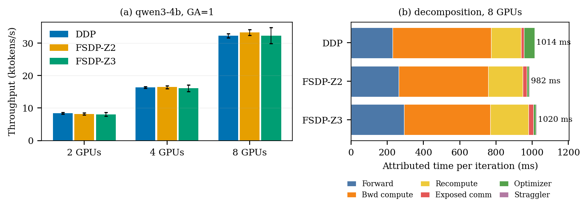

# ai2ml: DDP vs. FSDP training-iteration decomposition on NVSwitch A100

> A PyTorch-native harness and 189-run dataset that decomposes LLM training iterations (DDP vs. FSDP ZeRO-2/ZeRO-3, dense Qwen3 0.6B–32B) into compute, exposed communication, memory and overlap on a single 8×A100 NVSwitch node, so you can see *why* one strategy beats another and rerun it on your own hardware.

Companion code and data for the paper *Empirical Characterization of Communication–Computation Trade-offs in Distributed Training Strategies of LLMs on NVSwitch-Connected A100 Cloud Systems* (see [`paper/`](paper/)).

## What it measures

Every run trains one model under one strategy and attributes each iteration to

`T_iter = T_forward + (T_bwd_compute + T_recompute + T_exposed_comm) + T_optimizer + T_straggler + T_residual`

using a **two-pass protocol**: pass 1 gives clean CUDA-event timing, throughput and memory with no profiler attached; pass 2 re-runs under the PyTorch profiler to get NCCL collective time and counts, communication/computation overlap and exposed communication. Out-of-memory runs are recorded as results (`status=oom`) rather than discarded.

| Factor | Levels in the released study |
|---|---|
| Model (dense Qwen3) | 0.6B, 1.7B, 4B, 8B, 14B, 32B |
| Strategy | single GPU, DDP, FSDP-Z2 (`SHARD_GRAD_OP`), FSDP-Z3 (`FULL_SHARD`) |
| GPUs (one node) | 1, 2, 4, 8 |
| Gradient accumulation | 1, 2, 4, 8 |
| Fixed workload | bf16, gradient checkpointing, seq 2048, batch 2/GPU, synthetic tokens |

## Repository layout

```
src/            runner (torchrun entry point), strategy wrappers, instrumentation
orchestration/  launch_matrix.py: subprocess-per-run orchestrator with resume
configs/        base.yaml (workload/protocol), matrix.yaml (run grid), models.yaml
scripts/        post-processing and repair utilities (merge, calibrate, rebuild CSV)
analysis/       build_figures.py, nccl_tests.sh, sample_analysis.py, HTA overlap check
outputs/        all_experiments_summary.csv (189 runs, 69+ columns), per-run JSON,
                nccl-tests bandwidth curves, thesis figures
paper/          IEEE paper source, PDF and figures
docs/img/       figures used in this README
```

## Requirements

- Linux, NVIDIA GPUs with NCCL (≥2 GPUs for the distributed strategies), `torchrun` on `PATH`.
- Released results used: Python 3.10, PyTorch 2.11 (CUDA 13.0), NCCL 2.28.9, Transformers 5.5.4.
- Models are loaded with `from_pretrained` from the Hugging Face Hub (`Qwen/Qwen3-*`), so the first run needs internet access or a local HF cache. Training data are synthetic random tokens, so no dataset download is needed.

```bash
pip install torch transformers pyyaml numpy pandas matplotlib   # pick the torch build matching your CUDA
```

## Run the harness on your own hardware

Run everything from the repository root.

**1. Use your own output folder.** The launcher resumes against `<output_root>/all_experiments_summary.csv`, so the default `./outputs` (which holds the released dataset) would make it skip runs it thinks are done. Copy the config and change the root:

```bash
cp configs/base.yaml configs/my_hw.yaml
# edit configs/my_hw.yaml  ->  experiment.output_root: "./my_outputs"
```

**2. Preview a small test set.** Cell names follow `{model}_{strategy}_ws{N}_ga{A}_bs{B}_seq{S}_rep{R}`:

```bash
python -m orchestration.launch_matrix --base configs/my_hw.yaml --dry_run \
  --only qwen3-0.6b_ddp_ws2_ga1_bs2_seq2048_rep0 \
         qwen3-0.6b_fsdp_zero2_ws2_ga1_bs2_seq2048_rep0 \
         qwen3-0.6b_fsdp_zero3_ws2_ga1_bs2_seq2048_rep0
```

**3. Run it** (drop `--dry_run`; add `--profile_all` to also run pass 2 and get overlap and NCCL metrics, which roughly doubles wall-clock per run):

```bash
python -m orchestration.launch_matrix --base configs/my_hw.yaml --profile_all \
  --only qwen3-0.6b_ddp_ws2_ga1_bs2_seq2048_rep0 \
         qwen3-0.6b_fsdp_zero2_ws2_ga1_bs2_seq2048_rep0 \
         qwen3-0.6b_fsdp_zero3_ws2_ga1_bs2_seq2048_rep0
```

Each cell runs in its own `torchrun` process, so an OOM or NCCL crash in one cell is recorded and the rest continue. Re-running the same command skips finished cells (`--force` to redo).

**4. Scale up.** Select groups with `--groups group1_core group3_gradaccum ...` (see `configs/matrix.yaml`), cap runs with `--max_runs N`, and adapt the grid to your machine by editing `configs/matrix.yaml` (`world_sizes`, `models`) and `configs/models.yaml` (add other HF models by name, parameter count and decoder-layer class). GPUs with less than 80 GB will move the feasibility boundary; those cells simply come out as `status=oom`.

**5. Calibrate your interconnect (recommended).** Bandwidth-efficiency columns compare against a measured bus-bandwidth curve. The shipped curve is for the paper's NVSwitch node, so regenerate it on yours with [nccl-tests](https://github.com/NVIDIA/nccl-tests):

```bash
NCCL_TESTS_DIR=~/nccl-tests OUT_DIR=./my_outputs/nccl_tests bash analysis/nccl_tests.sh
# then set nccl_bw_curve_path in configs/my_hw.yaml to ./my_outputs/nccl_tests/bw_curves.json
```

**6. Post-process and plot.** The runner writes the raw backward timer; the calibrated recompute split is added afterwards:

```bash
python -m scripts.augment_recompute_calibration my_outputs/all_experiments_summary.csv
python analysis/build_figures.py --csv my_outputs/all_experiments_summary.csv --out_dir my_outputs/figures
```

Per-run artefacts land in `my_outputs/experiments/<cell>/` (`summary.json`, `metadata.json` with versions and GPU clocks, per-step timings, traces); one summary row per run is appended to the master CSV.

## Sample analysis (subset of the released results)

`analysis/sample_analysis.py` summarises one model across GPU counts. Run on the released data for **Qwen3-4B, gradient accumulation 1**:

```bash
python analysis/sample_analysis.py                                  # released dataset
python analysis/sample_analysis.py --csv my_outputs/all_experiments_summary.csv --model qwen3-0.6b
```



```
qwen3-4b, GA=1: throughput (tokens/s) [step-level CV %]
GPUs                 DDP             FSDP-Z2             FSDP-Z3
   2         8,421 [2.3]         8,220 [4.0]         8,074 [7.4]
   4        16,389 [1.4]        16,500 [2.7]        16,137 [6.5]
   8        32,341 [2.0]        33,385 [2.7]        32,351 [7.6]
```

How to read it:
- **(a)** At 4B the three strategies are within a few percent; the DDP→FSDP-Z2 switch happens between 2 and 4 GPUs but the gaps (0.7–3.2%) are close to the error bars, so this model size is a *near-crossover*.
- **(b)** At 8 GPUs, FSDP-Z2 is about 31 ms faster per iteration than DDP mainly because sharding cuts optimizer time (about 59 → 12 ms). FSDP-Z3 is about 38 ms slower than Z2: it issues twice the all-gathers and its forward pass lengthens.
- Backward (compute + recompute + exposed communication) is about 70–72% of the iteration for all three.

## Caveats

- **One run per cell.** The CV values are step-to-step dispersion within a run, not repeat-run variance, so small gaps (≲3%) are not statistically separated.
- **Communication volume is analytical.** NCCL device-kernel byte counts are unreliable; achieved-bandwidth columns use analytical volume divided by measured time. `measured_comm_volume_gb` should not be used.
- Results are specific to one virtualised A100/NVSwitch cloud node (measured all-reduce bus bandwidth ≈229 GB/s vs. ≈600 GB/s nominal), PyTorch-default tuning, and a fixed low-utilisation workload (batch 2, seq 2048). They do not transfer directly to multi-node or PCIe-only systems.

## Citation and license

If you use the code or dataset, please cite the paper (preprint/DOI to be added) by S. F. H. Gillani, T. ur Rehman, S. Latif, M. Ashraf and T. Saeed (NUST, Islamabad). Released under the MIT License (see [`LICENSE`](LICENSE)).
